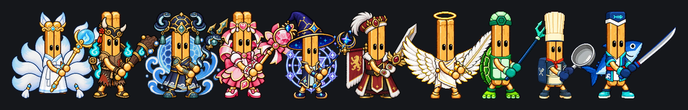
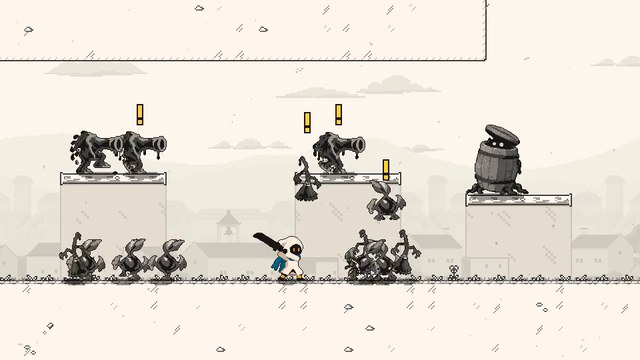
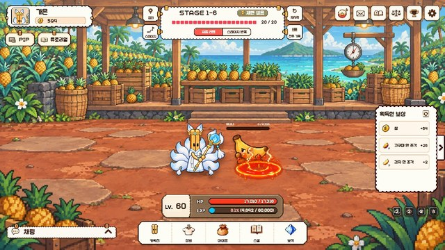
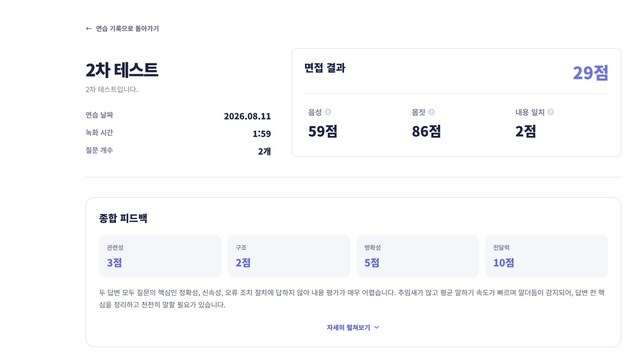

# 서가은 | 게임 UI, 테크니컬 아트

**게임 화면의 규칙을 정하고, 생성 AI 그림을 게임 규격으로 길들입니다.**

해상도, 테두리, 색 수 같은 규칙을 먼저 정하고, 엔진 밖에서 여러 안을 비교해 고른 뒤, 게임 안에서 직접 플레이하며 마지막 픽셀까지 맞춥니다.

🏆 **우수상** 한짝 (SSAFY 특화 프로젝트) &nbsp;|&nbsp; 🏆 **우수상** AIVO (SSAFY 공통 프로젝트)

🌐 **[포트폴리오 사이트 seogaeun03.github.io](https://seogaeun03.github.io)** &nbsp;|&nbsp; 📮 seogu0307@gmail.com

## 프로젝트

<table>
<tr>
<td width="33%" valign="top">

<h3><a href="https://github.com/Seogaeun03/deviant">DEVIANT</a></h3>
Unity 2D 액션 로그라이트 
2026.10 ~ 진행 중, 6인 
<b>팀장, 아트</b>
<ul>
<li>전투 HUD 도트 통일, 무기와 스킬 아이콘 54장</li>
<li>제작과 장착 흐름 재설계 (입력 14회 → 7회)</li>
<li>HTML 시험장에서 정하고 Unity로 옮기는 흐름</li>
</ul>
</td>
<td width="33%" valign="top">

<h3><a href="https://github.com/Seogaeun03/hanjjak">한짝</a></h3>
웹 방치형 게임, 실서비스 운영 
2026.08 ~ 09, 6인, 우수상 
<b>팀장, 디자인 총괄, 치장 제작</b>
<ul>
<li>생성 AI 장비를 고정 마네킹에 입히는 파이프라인</li>
<li>모션 네 칸을 한 장에 생성해 옷 흐름 해결</li>
<li>몬스터 90종 1,800프레임 발끝 0px 정합</li>
</ul>
</td>
<td width="33%" valign="top">

<h3><a href="https://github.com/Seogaeun03/aivo">AIVO</a></h3>
AI 발표 면접 코치 웹 서비스 
2026.07 ~ 08, 6인, 우수상 
<b>프론트엔드</b>
<ul>
<li>면접과 폴더 화면, 리포트 화면 구현</li>
<li>가짜 데이터와 실제 API 연결을 구분해 검수</li>
<li>리포트 그래프와 숫자 기준 정리</li>
</ul>
</td>
</tr>
</table>

## 다루는 것

| 분야 | 도구 | 어디서 |
|---|---|---|
| 게임 UI, 픽셀 아트 | 픽셀 편집기, Figma | DEVIANT HUD와 아이콘, 한짝 UI 전체 |
| 아트 파이프라인 | 생성 AI 이미지, Python 이미지 처리 | 한짝 치장과 몬스터, DEVIANT 모션 |
| 엔진 적용과 검수 | Unity | DEVIANT |
| 프로토타입, 프론트엔드 | HTML, CSS, JavaScript, Vue 3 | DEVIANT 시험장, AIVO |

## AI를 쓰는 방식

AI에게는 그림과 모션 초안, 반복 계산, 코드 작성을 맡깁니다. 규격과 검수 기준, 고르기, 마지막 픽셀 손질, 게임 안에서의 확인은 제가 합니다. 각 저장소에는 제 판단, AI가 한 일, 팀원의 몫을 나눠 적었습니다.

**[프로젝트 사례 모아 보기](https://github.com/Seogaeun03/portfolio)**
